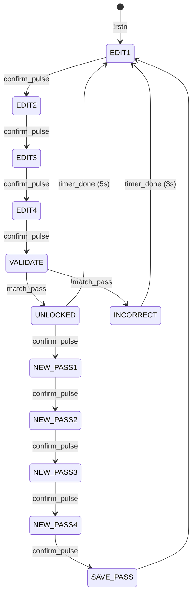

# SafeCrack Pro - Cofre Digital em FPGA

- **Disciplina:** CIN0130 - Sistemas Digitais
- **Professor:** Victor Medeiros
- **Equipe Desenvolvedora:**
  - **Caio Tenório** (*[GitHub](https://github.com/caiomta)* | *[LinkedIn](https://www.linkedin.com/in/caiomta)*)
  - **José Vinícius Albino** (*[GitHub](https://github.com/jva2-cyber)*)
  - **Lucas de Oliveira** (*[GitHub](https://github.com/0guruzet)*)
  - **Natália Bourbon** (*[GitHub](https://github.com/nataliabourbon)*)

## Visão Geral

O **SafeCrack Pro** é um sistema de cofre digital interativo desenvolvido em SystemVerilog e sintetizado na placa de desenvolvimento **Terasic DE2-115** (equipada com o FPGA **Altera Cyclone IV E EP4CE115F29**).

### Interface do Usuário

A interação com o cofre ocorre através dos botões de pressão, dos displays de 7 segmentos e dos barramentos de LEDs da placa:

#### Botões de Controle (`KEY[3:0]`)

- **`KEY[3]` (Decremento):** Decrementa o valor do dígito ativo, contando com *wrap-around* (após o 0 vai para 9);
- **`KEY[2]` (Incremento):** Incrementa o valor do dígito ativo, contando com *wrap-around* (após o 9 vai para 0);
- **`KEY[1]` (Confirmação):** Fixa o valor ajustado para o dígito ativo e avança para o dígito seguinte. Após o 4° dígito, inicia a validação (ou persistência, em caso de modo edição). Caso seja pressionado durante o estado desbloqueado, o sistema entra em modo de edição de senha;
- **`KEY[0]` (Reset):** Aciona o reset assíncrono (`rstn`), retornando para o estado inicial do sistema (mas sem resetar a senha persistida na memória, se alterada).
  
#### Displays de 7 Segmentos (`HEX[4:0]`)

- **`HEX[3:0]` (Senha Digitada):** Exibem os 4 dígitos da senha, da esquerda para a direita, sendo `HEX[3]` o primeiro dígito. O display correspondente à posição ativa é alterada em tempo real durante o ajuste. Após confirmar o último dígito ou usar o reset assíncrono, todos os dígitos são zerados;
- **`HEX[4]` (Dígito Ativo):** Exibe o índice do dígito que está atualmente em edição (iniciando em 1 e terminando em 4).

#### LEDs Vermelhos e Verdes:

- **Apenas Vermelhos Acesos:** Acontece por 3 segundos após a combinação inserida não bater com a senha definida em memória, indicando falha no acesso;
- **Apenas Verdes Acesos:** Acontece por 5 segundos após a combinação inserida bater com a senha definida em memória, indicando acesso bem-sucedido;
- **Vermelhos e Verdes Acesos:** Acontece para indicar que o sistema está em modo de edição da senha.

### Gerenciamento de Senha

- **Senha Padrão:** Ao iniciar o programa na placa, o cofre é inicializado automaticamente com a senha padrão `0000`;
- **Edição de Senha:** Ao pressionar o botão de confirmação enquanto o sistema está em estado desbloqueado, é possível inserir uma nova senha que será utilizada nas validações após a confirmação da edição. Se ocorrer reset durante o processo de edição, a senha anterior mantém-se.
- **Reset:** O reset assíncrono não redefine a senha para a padrão após alterada.


> [!NOTE]
> O desenvolvimento do projeto foi baseado nos seguintes requisitos: [📄Documentação](docs/requisitos_projeto.pdf)

## Máquina de Estados Finita (FSM)



> [!WARNING]
> Se o diagrama não estiver sendo rendenizado pelo seu leitor de Markdown, *[clique aqui para acessar o diagrama em PNG](./state-diagram.png)*.

### Descrição dos Estados

- **`EDIT1` a `EDIT4` (Digitação da Senha):** Estados de inserção dos 4 dígitos da senha para tentativa de acesso. Cada estado atribui o índice ativo a `selected_digit` (que vai de `2'd0` a `2'd3` e é convertido pelo driver do display para 1-4). A cada `confirm_pulse`, a FSM gera o pulso `save_digit` para registrar o dígito atual e avança para a posição seguinte. Ao confirmar o 4° dígito, avança para `VALIDATE`;
- **`VALIDATE` (Validação do Acesso):** Estado combinacional de tomada de decisão. Se a combinação digitada bater com a senha armazenada em memória (`match_pass == 1`), avança para `UNLOCKED`. Caso contrário (`match_pass == 0`), avança para `INCORRECT`;
- **`UNLOCKED` (Cofre Desbloqueado):** Ativa `unlocked`, zerando o display da senha inserida, retornando o índice `selected_digit` para `2'd0`, acionando os LEDs verdes e ativando o temporizador de 5s. Se o botão de confirmação for pressionado, gerando `confirm_pulse`, a FSM redireciona para o modo de edição de senha (`NEW_PASS1`). Caso contrário, ao esgotar do temporizador (`timer_done`), o sistema retorna para `EDIT1`. 
- **`INCORRECT` (Senha Incorreta):** Ativa `incorrect`, zerando o display da senha inserida, retornando o índice `selected_digit` para `2'd0`, acionando os LEDs vermelhos e ativando o temporizador de 3s. Ao término do temporizador (`timer_done`), o sistema retorna para `EDIT1`.
- **`NEW_PASS1` a `NEW_PASS4` (Edição de Senha):** Estados para digitação da nova combinação de 4 dígitos. Mantém o sinal `edit_mode` ativo, o que liga os LEDs verdes e vermelhos, sinalizando o modo de edição. A cada confirmação, armazena o dígito com o pulso `save_digit`. Após confirmar o 4° dígito, avança para `SAVE_PASS`.
- **`SAVE_PASS` (Persistência da Nova Senha):** Ativa simultaneamente `edit_mode` e `save_pass`, zerando o display da senha inserida, retornando o índice `selected_digit` para `2'd0` e sinalizando ao `password_manager` para sobrescrever a senha gravada na memória com a nova combinação. Imediatamente após, transiciona para `EDIT1`.

> [!NOTE]
> Ao aplicar o reset assícrono (`!rstn`) em qualquer estado, o programa retorna para `EDIT1`.

## Módulos

### Button Debouncer

O módulo **`btn_debouncer`** é responsável por sanitizar os sinais assíncronos vindos dos botões mecânicos da placa DE2-115 (`KEY`). Ele elimina o ruído mecânico (*bouncing*), evita problemas de metaestabilidade no domínio de clock do FPGA e garante a geração de um **pulso único de exatamente 1 ciclo de clock** por clique.

#### Parâmetros Genéricos

- **`CLK_FREQ`** (Padrão: `50_000_000` Hz): Frequência do clock de entrada. Na simulação, este parâmetro pode ser reduzido (ex.: `100`) para acelerar os testes.
- **`DEB_MS`** (Padrão: `20` ms): Tempo mínimo de estabilização exigido para validar o clique.

#### Funcionalidades e Implementação

- **Sincronização de 2 Estágios (Anti-metaestabilidade):** Utiliza dois flip-flops em cascata (`btn_sync0` e `btn_sync1`) para capturar o sinal assíncrono do botão e alinhá-lo com a borda de subida do clock (`clk`), prevenindo estados metaestáveis no sistema;
- **Adequação de Polaridade (`btn_active`):** Como os botões da DE2-115 são *active-low* (pressionado = `0`), o sinal sincronizado é invertido (`assign btn_active = !btn_sync1`), fazendo com que `1` represente o estado pressionado;
- **Filtragem de Ruído por Contagem (`deb_cnt`):** O sinal só é considerado estável se mantiver o novo nível lógico de forma ininterrupta por `DEB_CYCLES` (calculado a partir de `DEB_MS`). Qualquer oscilação mecânica no meio do processo reinicia a contagem (`deb_cnt <= '0`), garantindo que ruídos não sejam registrados como cliques válidos;
- **Detecção de Borda de Subida (`btn_pulse`):** Através da comparação entre o estado estável atual (`btn_stable`) e o estado no ciclo imediatamente anterior (`btn_prev`), a lógica combinacional `assign btn_pulse = btn_stable & !btn_prev` gera um único pulso com duração de 1 ciclo de clock. Isso impede que manter o botão pressionado gere múltiplos acionamentos indesejados.

#### Interface do Módulo (E/S)

| Porta | Tipo | Largura | Descrição |
| :--- | :--- | :--- | :--- |
| `clk` | Entrada | 1 bit | Clock principal do sistema (50 MHz na placa) |
| `rstn` | Entrada | 1 bit | Reset assíncrono ativo em nível baixo |
| `btn` | Entrada | 1 bit | Entrada bruta do botão mecânico (ativo em `0`) |
| `btn_pulse` | Saída | 1 bit | Pulso limpo de 1 ciclo indicando a confirmação do clique |

### Display Driver

O módulo `display_driver.sv` é a unidade combinacional responsável pela conversão dos valores numéricos BCD (0 a 9) para a codificação de 7 segmentos compatível com a placa Altera DE2-115 [64]. Ele controla os displays `HEX0` a `HEX3` para a exibição da combinação digitada e o display `HEX4` para indicar visualmente qual dígito está selecionado no momento para edição.

#### Comportamento e Regras de Decodificação
1. **Lógica de Ânodo Comum (Ativa em Nível Baixo `0`):** Os displays da DE2-115 acendem os segmentos quando o sinal correspondente está em nível lógico `0` [64]. O vetor de 7 bits mapeia a ordem `[6:0]` para os segmentos `[g, f, e, d, c, b, a]`.
2. **Exibição da Combinação (`HEX0` a `HEX3`):** Converte continuamente cada um dos 4 dígitos BCD (`entered_pass[3:0][3:0]`) nos respectivos padrões visuais dos 4 displays de combinação.
3. **Indicação do Dígito Ativo (`HEX4`):** Decodifica o índice do dígito atualmente em foco (`active_digit`), somando `+1` para exibir na tela o valor numérico de `1` a `4` no display `HEX4`.

#### Interface do Módulo (E/S)

| Sinal | Direção | Largura | Descrição |
| :--- | :--- | :--- | :--- |
| `entered_pass` | Entrada | `logic [3:0][3:0]` | Matriz com os 4 dígitos BCD da combinação atual. |
| `active_digit` | Entrada | `logic [1:0]` | Índice do dígito selecionado em edição (`0` a `3`). |
| `HEX0` | Saída | `logic [6:0]` | Sinais de 7 segmentos para o Dígito 1 da combinação. |
| `HEX1` | Saída | `logic [6:0]` | Sinais de 7 segmentos para o Dígito 2 da combinação. |
| `HEX2` | Saída | `logic [6:0]` | Sinais de 7 segmentos para o Dígito 3 da combinação. |
| `HEX3` | Saída | `logic [6:0]` | Sinais de 7 segmentos para o Dígito 4 da combinação. |
| `HEX4` | Saída | `logic [6:0]` | Sinais de 7 segmentos para a indicação do Dígito Ativo (`1` a `4`). |


### Input Handler

O módulo **`input_handler`** é responsável por integrar o tratamento de debounce para os três botões de interação (`keys[2:0]`), propagar o pulso de confirmação para a FSM e controlar o valor numérico do dígito que está sendo editado no momento (`digit_val`), aplicando a lógica de incremento, decremento e *wrap-around* (0 a 9).

#### Parâmetros Genéricos

- **`CLK_FREQ`** (Padrão: `50_000_000` Hz): Frequência do clock de entrada repassada às instâncias internas de `btn_debouncer`.

#### Funcionalidades e Implementação

- **Instanciação Generativa de Debouncers (`gen_deb`):** Utiliza um laço `generate` para instanciar três blocos `btn_debouncer`, garantindo a filtragem de ruído mecânico e a geração de um pulso de 1 ciclo de clock (`btn_pulse[2:0]`) para cada um dos botões:
  - `keys[0]`: Botão de confirmação.
  - `keys[1]`: Botão de incremento.
  - `keys[2]`: Botão de decremento.
- **Propagação da Confirmação (`confirm_pulse`):** Conecta o sinal limpo do botão de confirmação (`assign confirm_pulse = btn_pulse`) para ser consumido pela FSM e pelo Top-Level.
- **Controle Sequencial do Dígito (`digit_val`):** Registrador de 4 bits que armazena o valor BCD (0 a 9) exibido no display do dígito ativo:
  - **Incremento (`btn_pulse`):** Soma `1` ao valor atual. Se o valor for `9`, retorna para `0` (*wrap-around*).
  - **Decremento (`btn_pulse`):** Subtrai `1` do valor atual. Se o valor for `0`, pula para `9` (*wrap-around*).
- **Reinicialização de Dígito:** Reseta o registrador `digit_val` para `0` sempre que o reset assíncrono for ativado (`!rstn`) ou quando a confirmação for pressionada (`confirm_pulse`), garantindo que a edição do próximo dígito sempre inicie a partir do `0`.

#### Interface do Módulo (E/S)

| Porta | Tipo | Largura | Descrição |
| :--- | :--- | :--- | :--- |
| `clk` | Entrada | 1 bit | Clock principal do sistema (50 MHz) |
| `rstn` | Entrada | 1 bit | Reset assíncrono ativo em nível baixo |
| `keys` | Entrada | 3 bits | Botões brutos de entrada (`[0]`: confirmação, `[1]`: incremento, `[2]`: decremento) |
| `digit_val` | Saída | 4 bits | Valor BCD (0 a 9) do dígito atualmente em ajuste |
| `confirm_pulse` | Saída | 1 bit | Pulso limpo de 1 ciclo gerado ao confirmar o dígito |

### Led Controller

O módulo `led_controller.sv` é a unidade responsável pelo gerenciamento do feedback visual luminoso na placa Altera DE2-115. Ele decodifica os estados correntes da FSM principal (`safecrack_pro_fsm`) e aciona os barramentos de LEDs verdes (`LEDG`) e vermelhos (`LEDR`) de acordo com as regras de operação e os temporizadores do cofre.

#### Comportamento e Regras de Sinalização Visual
1. **Feedback de Sucesso (`UNLOCKED`):** Quando o cofre é liberado com a senha correta, o módulo aciona simultaneamente os 9 LEDs verdes da placa (`LEDG[8:0] = 9'b1_1111_1111`) pelo período de 5 segundos controlado pelo temporizador. Os LEDs vermelhos permanecem totalmente apagados.
2. **Feedback de Falha (`LOCKED_FAIL`):** Quando uma tentativa incorreta é inserida, o módulo aciona simultaneamente os 18 LEDs vermelhos da placa (`LEDR[17:0] = 18'b11_1111_1111_1111_1111`) pelo tempo de 3 segundos. Os LEDs verdes permanecem apagados.
3. **Sinalização de Modo Edição (`SET_NEW_PASS`):** Durante a fase de alteração dinâmica de senha, o controlador aciona simultaneamente os LEDs verdes e vermelhos, produzindo uma sinalização combinada (amarelo) para alertar o usuário sobre o modo de configuração.
4. **Estado de Repouso / Edição Normal:** Durante a navegação padrão dígito a dígito, todos os LEDs de feedback permanecem desligados.

#### Interface do Módulo (E/S)

| Sinal | Direção | Largura | Descrição |
| :--- | :--- | :--- | :--- |
| `clk` | Entrada | `logic` (1 bit) | Clock principal do sistema (50 MHz). |
| `rst_n` | Entrada | `logic` (1 bit) | Reset global do sistema (ativo em nível baixo `0`). |
| `state_unlocked` | Entrada | `logic` (1 bit) | Flag da FSM indicando sucesso na abertura (ativado por 5s). |
| `state_fail` | Entrada | `logic` (1 bit) | Flag da FSM indicando falha de verificação (ativado por 3s). |
| `state_new_pass` | Entrada | `logic` (1 bit) | Flag da FSM indicando o Modo de Troca/Edição de Senha. |
| `LEDG` | Saída | `logic [8:0]` | Barramento de acionamento dos 9 LEDs verdes (DE2-115). |
| `LEDR` | Saída | `logic [17:0]` | Barramento de acionamento dos 18 LEDs vermelhos (DE2-115). |

### Password Manager

O módulo `password_manager` é o componente central responsável pela memória e comparação de credenciais no **SafeCrack Pro**. Ele gerencia o armazenamento persistente da senha em registradores BCD de 4 dígitos (4 bits por dígito), realiza a comparação em tempo real com a entrada do usuário e executa a atualização de senha em tempo de execução (*runtime*) quando solicitado pela FSM principal.

#### Comportamento e Regras de Negócio

1. **Inicialização (Power-On):** Na energização da FPGA, o registrador interno `internal_pass` é carregado com a senha padrão de fábrica `0000` (`'{4'd0, 4'd0, 4'd0, 4'd0}`).
2. **Preservação de Memória no Reset de Interface:** O sinal de reset do sistema (`reset_pass`) reinicia a interface visual e o estado da FSM, **mas não altera a senha armazenada em `internal_pass`**. Isso garante que um reset acidental não desconfigure a senha definida pelo usuário.
3. **Escrita em Runtime (`save_pass`):** A atualização da senha só ocorre mediante um pulso síncrono no sinal `save_pass` (gerado pela FSM ao confirmar o 4º dígito no Modo de Edição `SET_NEW_PASS`). Nesse instante, o valor presente em `entered_pass` é copiado para `internal_pass`.
4. **Comparação Combinacional (`match_pass`):** A verificação da senha é puramente combinacional: `match_pass` é elevado para nível lógico alto (`1`) instantaneamente quando `entered_pass == internal_pass`.

#### Interface do Módulo (E/S)

| Sinal          | Direção | Largura            | Descrição                                                               |
| -------------- | ------- | ------------------ | ----------------------------------------------------------------------- |
| `clk`          | Entrada | `logic` (1 bit)    | Clock principal do sistema (50 MHz).                                    |
| `reset_pass`   | Entrada | `logic` (1 bit)    | Sinal de reset síncrono/assíncrono da interface (ativo em `1`).         |
| `entered_pass` | Entrada | `logic [3:0][3:0]` | Vetor de 4 dígitos BCD (4x4 bits) com a combinação digitada.            |
| `save_pass`    | Entrada | `logic` (1 bit)    | Pulso de habilitação de escrita enviado pela FSM no Modo Edição.        |
| `match_pass`   | Saída   | `logic` (1 bit)    | Flag de correspondência (`1` = senha correta, `0` = senha incorreta). |
| `stored_pass`  | Saída   | `logic [3:0][3:0]` | Barramento de saída contendo a senha ativa na memória interna.          |


### Timer Counter

O módulo **`timer_counter`** é responsável pelo controle de tempo dos feedbacks visuais do cofre digital. Ele contabiliza a duração exata dos estados de acesso concedido (LEDs verdes) e acesso negado (LEDs vermelhos), emitindo o sinal `timer_done` para notificar a FSM que o tempo de exibição foi concluído.

#### Parâmetros Genéricos

* **`CLK_FREQ`** (Padrão: `50_000_000` Hz): Frequência do clock de entrada. Na simulação, este parâmetro pode ser reduzido para acelerar a contagem do temporizador.

#### Funcionalidades e Implementação

- **Seleção Dinâmica do Intervalo de Tempo (`timer_mode`):** Calcula o número total de ciclos de clock necessários (`timer_cycles`) com base no modo selecionado:
  - `timer_mode = 0`: Contagem de **3 segundos** (utilizado no estado de falha/senha incorreta).
  - `timer_mode = 1`: Contagem de **5 segundos** (utilizado no estado de sucesso/desbloqueio).
- **Habilitação e Controle de Contagem (`timer_enable`):** A contagem só é executada enquanto o sinal `timer_enable` estiver em nível alto (`1`). Caso o temporizador seja desativado (`timer_enable = 0`) ou o reset assíncrono seja acionado (`!rstn`), o contador `cnt` e a saída `timer_done` são zerados imediatamente.
- **Geração do Sinal de Término (`timer_done`):** Enquanto a contagem estiver em andamento, `cnt` é incrementado a cada ciclo de clock. Ao atingir o limite `timer_cycles - 1`, o módulo ativa a saída `timer_done = 1`, sinalizando à FSM que o tempo estipulado encerrou e que o sistema pode retornar ao estado inicial.

#### Interface do Módulo (E/S)

| Porta | Tipo | Largura | Descrição |
| :--- | :--- | :--- | :--- |
| `clk` | Entrada | 1 bit | Clock principal do sistema (50 MHz) |
| `rstn` | Entrada | 1 bit | Reset assíncrono ativo em nível baixo |
| `timer_enable` | Entrada | 1 bit | Sinal de habilitação para iniciar a contagem |
| `timer_mode` | Entrada | 1 bit | Seleciona o tempo de exibição (`0`: 3s, `1`: 5s) |
| `timer_done` | Saída | 1 bit | Sinal de conclusão da contagem |

## Instruções de Compilação e Pinagem

### Passo a Passo para Compilação no Quartus Prime e Gravação na FPGA

1. **Abertura do Projeto:**

  * Abra o **Quartus Prime / II**.
  * Acesse **File &gt; Open Project** e selecione o arquivo do projeto na pasta raiz do repositório (`safecrack_pro_top.qpf`).
  * Garanta que a entidade principal (*Top-Level Entity*) esteja definida como `safecrack_pro_top`.
2. **Seleção do Dispositivo FPGA:**

  * Acesse **Assignments &gt; Device**.
  * Família: **Cyclone IV E**.
  * Modelo do chip: **`EP4CE115F29C7`** (Altera DE2-115).
3. **Verificação dos Arquivos do Projeto:**

  * Certifique-se de que todos os módulos RTL (`safecrack_pro_top.sv`, `safecrack_pro_fsm.sv`, `password_manager.sv`, `input_handler.sv`, `timer_counter.sv`, `display_driver.sv`, `led_controller.sv`) estejam presentes na hierarquia.
  * *Nota:* Os arquivos contidos na pasta `tb/` não devem ser incluídos na compilação do Quartus.
4. **Atribuição de Pinos (Pin Assignments):**

  * Importe as atribuições de pinos via **Assignments &gt; Import Assignments** selecionando o arquivo `.qsf` do repositório, ou abra o **Pin Planner** (`Ctrl + Shift + N`) e confirme os mapeamentos conforme a tabela de mapeamento de pinos abaixo.
5. **Compilação Completa (Full Compilation):**

  * Execute a compilação clicando duas vezes em **Start Compilation** no painel *Tasks* (ou atalho `Ctrl + L`).
  * Verifique se o compilador encerra com 0 erros, gerando o arquivo gravável `output_files/safecrack_pro_top.sof`.
6. **Gravação via JTAG (Quartus Programmer):**

  * Conecte o cabo USB-Blaster entre a porta USB do computador e a porta **USB-Blaster** da placa DE2-115.
  * Conecte a fonte de alimentação 12V e confirme que a chave `SW19` está na posição **RUN**. Ligue a placa no botão vermelho **Power**.
  * Abra **Tools &gt; Programmer**.
  * Clique em **Hardware Setup...** e selecione **USB-Blaster [USB-0]**.
  * Garanta que o modo esteja configurado para **JTAG**.
  * Se o arquivo não estiver carregado, clique em **Add File...** e selecione `output_files/safecrack_pro_top.sof`.
  * Marque a caixa **Program/Configure** na linha do dispositivo `EP4CE115` e clique em **Start**.
  * Aguarde o progresso atingir **100% (Successful)**.

---

### Tabela Completa de Mapeamento de Pinos (Altera DE2-115)

A tabela a seguir apresenta a atribuição exata entre as portas de E/S do módulo Top-Level (`safecrack_pro_top.sv`) e os pinos físicos do FPGA Cyclone IV E na placa DE2-115. Também é possível analisar a pinagem pelo arquivo CSV exportado diretamente do Quartus, disponível *[aqui](./pin-assignments.csv)*.

### Clock e Controles Globais

| Sinal Top-Level | Pino FPGA | Componente Hardware DE2-115                                    | Padrão I/O            |
| --------------- | --------- | -------------------------------------------------------------- | --------------------- |
| `CLOCK_50`      | `PIN_Y2`  | Oscilador de Clock Integrado 50 MHz                            | 3.3-V LVTTL           |
| `KEY[0]`        | `PIN_M23` | Botão Push-Button `KEY0` (Reset da Interface / Digitação)      | 3.3-V LVTTL (Ativo 0) |
| `KEY[1]`        | `PIN_M21` | Botão Push-Button `KEY1` (Confirma Dígito / Entra Modo Edição) | 3.3-V LVTTL (Ativo 0) |
| `KEY[2]`        | `PIN_N21` | Botão Push-Button `KEY2` (Incrementa BCD `0` a `9`)            | 3.3-V LVTTL (Ativo 0) |
| `KEY[3]`        | `PIN_R24` | Botão Push-Button `KEY3` (Decrementa BCD `9` a `0`)            | 3.3-V LVTTL (Ativo 0) |

### Displays de 7 Segmentos (Ânodo Comum - Ativos em Nível Baixo `0`)

| Barramento Display | Pinos FPGA (`G F E D C B A`)                                           | Descrição Visual                             |
| ------------------ | ---------------------------------------------------------------------- | -------------------------------------------- |
| `HEX0[6:0]`        | `PIN_H22, PIN_J22, PIN_L25, PIN_L26, PIN_E17, PIN_F22, PIN_G18`        | Dígito 1 da Combinação (BCD 1)               |
| `HEX1[6:0]`        | `PIN_U24, PIN_U23, PIN_S25, PIN_W26, PIN_W27, PIN_Y26, PIN_W22`        | Dígito 2 da Combinação (BCD 2)               |
| `HEX2[6:0]`        | `PIN_W24, PIN_U22, PIN_Y25, PIN_C21, PIN_B21, PIN_R22, PIN_R23`        | Dígito 3 da Combinação (BCD 3)               |
| `HEX3[6:0]`        | `PIN_V21, PIN_U21, PIN_AB20, PIN_AA21, PIN_AD24, PIN_AF23, PIN_Y19`    | Dígito 4 da Combinação (BCD 4)               |
| `HEX4[6:0]`        | `PIN_AB19, PIN_AA19, PIN_AG21, PIN_AH21, PIN_AE19, PIN_AF19, PIN_AE18` | Número do Dígito Ativo em Edição (`1` a `4`) |

### Barramentos de Feedback por LEDs

| Sinal Top-Level  | Pinos FPGA                                                                                                                                                         | Estado / Função Visual                                                                       |
| ---------------- | ------------------------------------------------------------------------------------------------------------------------------------------------------------------ | -------------------------------------------------------------------------------------------- |
| `LEDG[8:0]`      | `PIN_E21, PIN_E22, PIN_E25, PIN_E24, PIN_H21, PIN_G20, PIN_G22, PIN_G21, PIN_F17`                                                                                  | **LEDs Verdes:** Acesos por 5s no Desbloqueio (`UNLOCKED`)                                   |
| `LEDR[17:0]`     | `PIN_G19, PIN_F19, PIN_E19, PIN_F21, PIN_F18, PIN_E18, PIN_J19, PIN_H19, PIN_J17, PIN_G17, PIN_J15, PIN_H16, PIN_J16, PIN_H17, PIN_F15, PIN_G15, PIN_G16, PIN_H15` | **LEDs Vermelhos:** Acesos por 3s em caso de Erro (`LOCKED_FAIL`)                            |
| `LEDG` + `LEDR` | Todos os LEDs acima acesos simultaneamente                                                                                                                         | **LED Amarelo (Combinação Verde+Vermelho):** Indica Modo de Edição de Senha (`SET_NEW_PASS`) |

## Problemas Conhecidos

Até o presente momento, apenas um problema foi detectado no programa.

### Modificação Residual do Dígito Inicial nos Estados de Feedback (UNLOCKED e INCORRECT):

- **Descrição:** Durante a execução dos temporizadores de feedback visual (LEDs verdes acesos por 5s no estado UNLOCKED ou LEDs vermelhos acesos por 3s no estado INCORRECT), os botões de incremento e decremento do input_handler permanecem ativos.
- **Sintoma:** O usuário consegue alterar o valor do primeiro dígito nos displays enquanto as luzes de feedback estão acesas. Se o botão de confirmação for pressionado durante esses estados, o primeiro dígito é simplesmente resetado para 0 (devido à lógica interna de limpeza do dígito ao confirmar).
- **Impacto e Recuperação:** Trata-se de um comportamento estritamente cosmético/temporário que não afeta a segurança do cofre, a integridade da FSM ou a senha salva em memória. Assim que o temporizador expira (timer_done), a FSM transiciona de volta para o estado inicial (EDIT1) e a navegação/edição retorna ao seu funcionamento 100% normal.

## Waveforms e Output do Testbench Top-Level

> [!NOTE]
> O PDF contendo as waveforms é acessível *[aqui](./docs/waveforms.pdf)*.

### Output

```txt
# =========================================================
#    INICIANDO TESTBENCH DO SAFECRACK PRO TOP
# =========================================================
# 
# [TB] Passo 0: Aplicando Reset (KEY0)...
# [TB] Senha Inicial em Memoria: 0000
# 
# [TB] Passo 1: Digitando Senha Incorreta (0001)...
#    [TB] Digitando posição [3] = 0...
#    [TB] Digitando posição [2] = 0...
#    [TB] Digitando posição [1] = 0...
#    [TB] Digitando posição [0] = 1...
# [TB SUCCESS] Feedback INCORRECT ativado! (LEDs Vermelhos)
# [TB] Aguardando fim do temporizador de erro (3s)...
# [TB] Retornou ao estado inicial EDIT1.
# 
# [TB] Passo 2: Digitando Senha Correta (0000)...
#    [TB] Digitando posição [3] = 0...
#    [TB] Digitando posição [2] = 0...
#    [TB] Digitando posição [1] = 0...
#    [TB] Digitando posição [0] = 0...
# [TB SUCCESS] Cofre DESBLOQUEADO com sucesso! (LEDs Verdes)
# [TB] Aguardando fim do temporizador de desbloqueio (5s)...
# [TB] Retornou ao estado inicial EDIT1.
# 
# [TB] Passo 3: Desbloqueando para entrar no Modo de Edicao de Senha...
#    [TB] Digitando posição [3] = 0...
#    [TB] Digitando posição [2] = 0...
#    [TB] Digitando posição [1] = 0...
#    [TB] Digitando posição [0] = 0...
# [TB] Pressionando confirmacao para entrar em Modo Edit (NEW_PASS1)...
# [TB SUCCESS] Entrou no Modo de Edição de Senha (edit_mode = 1)!
# [TB] Digitando Nova Senha (1234)...
#    [TB] Digitando posição [3] = 1...
#    [TB] Digitando posição [2] = 2...
#    [TB] Digitando posição [1] = 3...
#    [TB] Digitando posição [0] = 4...
# [TB SUCCESS] Nova Senha salva em memoria! Guardado: 1234
# 
# [TB] Passo 4: Testando login com a Nova Senha Salva (1234)...
#    [TB] Digitando posição [3] = 1...
#    [TB] Digitando posição [2] = 2...
#    [TB] Digitando posição [1] = 3...
#    [TB] Digitando posição [0] = 4...
# [TB SUCCESS] Desbloqueado com a NOVA SENHA!
# 
# =========================================================
#    SIMULACAO CONCLUIDA COM SUCESSO! TODOS OS TESTES PASSARAM.
# =========================================================
```