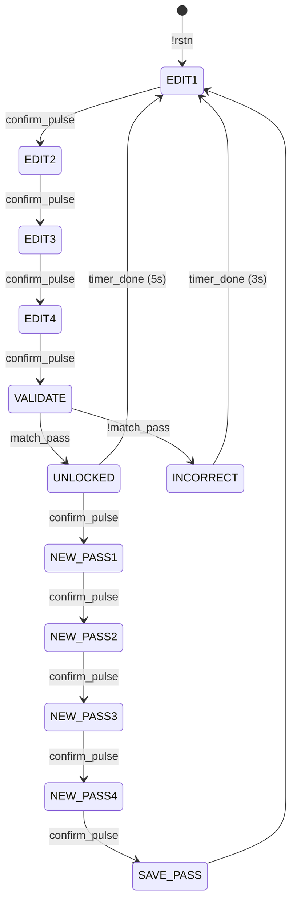

# SafeCrack Pro - Cofre Digital em FPGA

- **Disciplina:** CIN0130 - Sistemas Digitais
- **Professor:** Victor Medeiros

### Equipe Desenvolvedora

- **Caio Tenório** (*[GitHub](https://github.com/caiomta)* | *[LinkedIn](https://www.linkedin.com/in/caiomta)*)
- **José Vinícius Albino** (*[GitHub](https://github.com/jva2-cyber)*)
- **Lucas de Oliveira** (*[GitHub](https://github.com/0guruzet)*)
- **Natália Bourbon** (*[GitHub](https://github.com/nataliabourbon)*)

## Visão Geral

O **SafeCrack Pro** é um sistema de cofre digital interativo desenvolvido em SystemVerilog e sintetizado na placa de desenvolvimento **Terasic DE2-115** (equipada com o FPGA **Altera Cyclone IV E EP4CE115F29**).

### Interface do Usuário

A interação com o cofre ocorre através dos botões de pressão, dos displays de 7 segmentos e dos barramentos de LEDs da placa:

#### Botões de Controle (`KEY[3:0]`)

- **`KEY[3]` (Decremento):** Decrementa o valor do dígito ativo, contando com *wrap-around* (após o 0 vai para 9);
- **`KEY[2]` (Incremento):** Incrementa o valor do dígito ativo, contando com *wrap-around* (após o 9 vai para 0);
- **`KEY[1]` (Confirmação):** Fixa o valor ajustado para o dígito ativo e avança para o dígito seguinte. Após o 4° dígito, inicia a validação (ou persistência, em caso de modo edição). Caso seja pressionado durante o estado desbloqueado, o sistema entra em modo de edição de senha;
- **`KEY[0]` (Reset):** Aciona o reset assíncrono (`rstn`), retornando para o estado inicial do sistema (mas sem resetar a senha persistida na memória, se alterada).
  
#### Displays de 7 Segmentos (`HEX[4:0]`)

- **`HEX[3:0]` (Senha Digitada):** Exibem os 4 dígitos da senha, da esquerda para a direita, sendo `HEX[3]` o primeiro dígito. O display correspondente à posição ativa é alterada em tempo real durante o ajuste. Após confirmar o último dígito ou usar o reset assíncrono, todos os dígitos são zerados;
- **`HEX[4]` (Dígito Ativo):** Exibe o índice do dígito que está atualmente em edição (iniciando em 1 e terminando em 4).

#### LEDs Vermelhos e Verdes:

- **Apenas Vermelhos Acesos:** Acontece por 3 segundos após a combinação inserida não bater com a senha definida em memória, indicando falha no acesso;
- **Apenas Verdes Acesos:** Acontece por 5 segundos após a combinação inserida bater com a senha definida em memória, indicando acesso bem-sucedido;
- **Vermelhos e Verdes Acesos:** Acontece para indicar que o sistema está em modo de edição da senha.

### Gerenciamento de Senha

- **Senha Padrão:** Ao iniciar o programa na placa, o cofre é inicializado automaticamente com a senha padrão `0000`;
- **Edição de Senha:** Ao pressionar o botão de confirmação enquanto o sistema está em estado desbloqueado, é possível inserir uma nova senha que será utilizada nas validações após a confirmação da edição. Se ocorrer reset durante o processo de edição, a senha anterior mantém-se.
- **Reset:** O reset assíncrono não redefine a senha para a padrão após alterada.

## Máquina de Estados Finita (FSM)

> [!NOTE]
> Se o diagrama não estiver sendo rendenizado pelo seu leitor de Markdown, *[clique aqui para acessar o diagrama em PNG](./state-diagram.png)*.

- **`EDIT1` a `EDIT4` (Digitação da Senha):** Estados de inserção dos 4 dígitos da senha para tentativa de acesso. Cada estado atribui o índice ativo a `selected_digit` (que vai de `2'd0` a `2'd3` e é convertido pelo driver do display para 1-4). A cada `confirm_pulse`, a FSM gera o pulso `save_digit` para registrar o dígito atual e avança para a posição seguinte. Ao confirmar o 4° dígito, avança para `VALIDATE`.