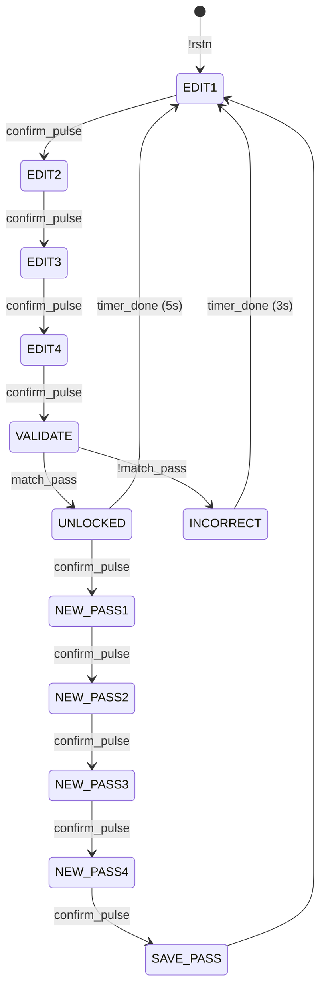

# SafeCrack Pro - Cofre Digital em FPGA

- **Disciplina:** CIN0130 - Sistemas Digitais
- **Professor:** Victor Medeiros
- **Equipe Desenvolvedora:**
  - **Caio Tenório** (*[GitHub](https://github.com/caiomta)* | *[LinkedIn](https://www.linkedin.com/in/caiomta)*)
  - **José Vinícius Albino** (*[GitHub](https://github.com/jva2-cyber)*)
  - **Lucas de Oliveira** (*[GitHub](https://github.com/0guruzet)*)
  - **Natália Bourbon** (*[GitHub](https://github.com/nataliabourbon)*)

## Visão Geral

O **SafeCrack Pro** é um sistema de cofre digital interativo desenvolvido em SystemVerilog e sintetizado na placa de desenvolvimento **Terasic DE2-115** (equipada com o FPGA **Altera Cyclone IV E EP4CE115F29**).

### Interface do Usuário

A interação com o cofre ocorre através dos botões de pressão, dos displays de 7 segmentos e dos barramentos de LEDs da placa:

#### Botões de Controle (`KEY[3:0]`)

- **`KEY[3]` (Decremento):** Decrementa o valor do dígito ativo, contando com *wrap-around* (após o 0 vai para 9);
- **`KEY[2]` (Incremento):** Incrementa o valor do dígito ativo, contando com *wrap-around* (após o 9 vai para 0);
- **`KEY[1]` (Confirmação):** Fixa o valor ajustado para o dígito ativo e avança para o dígito seguinte. Após o 4° dígito, inicia a validação (ou persistência, em caso de modo edição). Caso seja pressionado durante o estado desbloqueado, o sistema entra em modo de edição de senha;
- **`KEY[0]` (Reset):** Aciona o reset assíncrono (`rstn`), retornando para o estado inicial do sistema (mas sem resetar a senha persistida na memória, se alterada).
  
#### Displays de 7 Segmentos (`HEX[4:0]`)

- **`HEX[3:0]` (Senha Digitada):** Exibem os 4 dígitos da senha, da esquerda para a direita, sendo `HEX[3]` o primeiro dígito. O display correspondente à posição ativa é alterada em tempo real durante o ajuste. Após confirmar o último dígito ou usar o reset assíncrono, todos os dígitos são zerados;
- **`HEX[4]` (Dígito Ativo):** Exibe o índice do dígito que está atualmente em edição (iniciando em 1 e terminando em 4).

#### LEDs Vermelhos e Verdes:

- **Apenas Vermelhos Acesos:** Acontece por 3 segundos após a combinação inserida não bater com a senha definida em memória, indicando falha no acesso;
- **Apenas Verdes Acesos:** Acontece por 5 segundos após a combinação inserida bater com a senha definida em memória, indicando acesso bem-sucedido;
- **Vermelhos e Verdes Acesos:** Acontece para indicar que o sistema está em modo de edição da senha.

### Gerenciamento de Senha

- **Senha Padrão:** Ao iniciar o programa na placa, o cofre é inicializado automaticamente com a senha padrão `0000`;
- **Edição de Senha:** Ao pressionar o botão de confirmação enquanto o sistema está em estado desbloqueado, é possível inserir uma nova senha que será utilizada nas validações após a confirmação da edição. Se ocorrer reset durante o processo de edição, a senha anterior mantém-se.
- **Reset:** O reset assíncrono não redefine a senha para a padrão após alterada.

## Máquina de Estados Finita (FSM)

> [!WARNING]
> Se o diagrama não estiver sendo rendenizado pelo seu leitor de Markdown, *[clique aqui para acessar o diagrama em PNG](./state-diagram.png)*.

### Descrição dos Estados

- **`EDIT1` a `EDIT4` (Digitação da Senha):** Estados de inserção dos 4 dígitos da senha para tentativa de acesso. Cada estado atribui o índice ativo a `selected_digit` (que vai de `2'd0` a `2'd3` e é convertido pelo driver do display para 1-4). A cada `confirm_pulse`, a FSM gera o pulso `save_digit` para registrar o dígito atual e avança para a posição seguinte. Ao confirmar o 4° dígito, avança para `VALIDATE`;
- **`VALIDATE` (Validação do Acesso):** Estado combinacional de tomada de decisão. Se a combinação digitada bater com a senha armazenada em memória (`match_pass == 1`), avança para `UNLOCKED`. Caso contrário (`match_pass == 0`), avança para `INCORRECT`;
- **`UNLOCKED` (Cofre Desbloqueado):** Ativa `unlocked`, zerando o display da senha inserida, retornando o índice `selected_digit` para `2'd0`, acionando os LEDs verdes e ativando o temporizador de 5s. Se o botão de confirmação for pressionado, gerando `confirm_pulse`, a FSM redireciona para o modo de edição de senha (`NEW_PASS1`). Caso contrário, ao esgotar do temporizador (`timer_done`), o sistema retorna para `EDIT1`. 
- **`INCORRECT` (Senha Incorreta):** Ativa `incorrect`, zerando o display da senha inserida, retornando o índice `selected_digit` para `2'd0`, acionando os LEDs vermelhos e ativando o temporizador de 3s. Ao término do temporizador (`timer_done`), o sistema retorna para `EDIT1`.
- **`NEW_PASS1` a `NEW_PASS4` (Edição de Senha):** Estados para digitação da nova combinação de 4 dígitos. Mantém o sinal `edit_mode` ativo, o que liga os LEDs verdes e vermelhos, sinalizando o modo de edição. A cada confirmação, armazena o dígito com o pulso `save_digit`. Após confirmar o 4° dígito, avança para `SAVE_PASS`.
- **`SAVE_PASS` (Persistência da Nova Senha):** Ativa simultaneamente `edit_mode` e `save_pass`, zerando o display da senha inserida, retornando o índice `selected_digit` para `2'd0` e sinalizando ao `password_manager` para sobrescrever a senha gravada na memória com a nova combinação. Imediatamente após, transiciona para `EDIT1`.

> [!NOTE]
> Ao aplicar o reset assícrono (`!rstn`) em qualquer estado, o programa retorna para `EDIT1`.

## Módulos

### Button Debouncer

O módulo **`btn_debouncer`** é responsável por sanitizar os sinais assíncronos vindos dos botões mecânicos da placa DE2-115 (`KEY`). Ele elimina o ruído mecânico (*bouncing*), evita problemas de metaestabilidade no domínio de clock do FPGA e garante a geração de um **pulso único de exatamente 1 ciclo de clock** por clique.

#### Parâmetros Genéricos

- **`CLK_FREQ`** (Padrão: `50_000_000` Hz): Frequência do clock de entrada. Na simulação, este parâmetro pode ser reduzido (ex.: `100`) para acelerar os testes.
- **`DEB_MS`** (Padrão: `20` ms): Tempo mínimo de estabilização exigido para validar o clique.

#### Funcionalidades e Implementação

- **Sincronização de 2 Estágios (Anti-metaestabilidade):** Utiliza dois flip-flops em cascata (`btn_sync0` e `btn_sync1`) para capturar o sinal assíncrono do botão e alinhá-lo com a borda de subida do clock (`clk`), prevenindo estados metaestáveis no sistema;
- **Adequação de Polaridade (`btn_active`):** Como os botões da DE2-115 são *active-low* (pressionado = `0`), o sinal sincronizado é invertido (`assign btn_active = !btn_sync1`), fazendo com que `1` represente o estado pressionado;
- **Filtragem de Ruído por Contagem (`deb_cnt`):** O sinal só é considerado estável se mantiver o novo nível lógico de forma ininterrupta por `DEB_CYCLES` (calculado a partir de `DEB_MS`). Qualquer oscilação mecânica no meio do processo reinicia a contagem (`deb_cnt <= '0`), garantindo que ruídos não sejam registrados como cliques válidos;
- **Detecção de Borda de Subida (`btn_pulse`):** Através da comparação entre o estado estável atual (`btn_stable`) e o estado no ciclo imediatamente anterior (`btn_prev`), a lógica combinacional `assign btn_pulse = btn_stable & !btn_prev` gera um único pulso com duração de 1 ciclo de clock. Isso impede que manter o botão pressionado gere múltiplos acionamentos indesejados.

#### Interface do Módulo (E/S)

| Porta | Tipo | Largura | Descrição |
| :--- | :--- | :--- | :--- |
| `clk` | Entrada | 1 bit | Clock principal do sistema (50 MHz na placa) |
| `rstn` | Entrada | 1 bit | Reset assíncrono ativo em nível baixo |
| `btn` | Entrada | 1 bit | Entrada bruta do botão mecânico (ativo em `0`) |
| `btn_pulse` | Saída | 1 bit | Pulso limpo de 1 ciclo indicando a confirmação do clique |

### Display Driver

### Input Handler

O módulo **`input_handler`** é responsável por integrar o tratamento de debounce para os três botões de interação (`keys[2:0]`), propagar o pulso de confirmação para a FSM e controlar o valor numérico do dígito que está sendo editado no momento (`digit_val`), aplicando a lógica de incremento, decremento e *wrap-around* (0 a 9).

#### Parâmetros Genéricos

- **`CLK_FREQ`** (Padrão: `50_000_000` Hz): Frequência do clock de entrada repassada às instâncias internas de `btn_debouncer`.

#### Funcionalidades e Implementação

- **Instanciação Generativa de Debouncers (`gen_deb`):** Utiliza um laço `generate` para instanciar três blocos `btn_debouncer`, garantindo a filtragem de ruído mecânico e a geração de um pulso de 1 ciclo de clock (`btn_pulse[2:0]`) para cada um dos botões:
  - `keys[0]`: Botão de confirmação.
  - `keys[1]`: Botão de incremento.
  - `keys[2]`: Botão de decremento.
- **Propagação da Confirmação (`confirm_pulse`):** Conecta o sinal limpo do botão de confirmação (`assign confirm_pulse = btn_pulse`) para ser consumido pela FSM e pelo Top-Level.
- **Controle Sequencial do Dígito (`digit_val`):** Registrador de 4 bits que armazena o valor BCD (0 a 9) exibido no display do dígito ativo:
  - **Incremento (`btn_pulse`):** Soma `1` ao valor atual. Se o valor for `9`, retorna para `0` (*wrap-around*).
  - **Decremento (`btn_pulse`):** Subtrai `1` do valor atual. Se o valor for `0`, pula para `9` (*wrap-around*).
- **Reinicialização de Dígito:** Reseta o registrador `digit_val` para `0` sempre que o reset assíncrono for ativado (`!rstn`) ou quando a confirmação for pressionada (`confirm_pulse`), garantindo que a edição do próximo dígito sempre inicie a partir do `0`.

#### Interface do Módulo (E/S)

| Porta | Tipo | Largura | Descrição |
| :--- | :--- | :--- | :--- |
| `clk` | Entrada | 1 bit | Clock principal do sistema (50 MHz) |
| `rstn` | Entrada | 1 bit | Reset assíncrono ativo em nível baixo |
| `keys` | Entrada | 3 bits | Botões brutos de entrada (`[0]`: confirmação, `[1]`: incremento, `[2]`: decremento) |
| `digit_val` | Saída | 4 bits | Valor BCD (0 a 9) do dígito atualmente em ajuste |
| `confirm_pulse` | Saída | 1 bit | Pulso limpo de 1 ciclo gerado ao confirmar o dígito |

### Led Controller

### Password Manager

### Timer Counter

O módulo **`timer_counter`** é responsável pelo controle de tempo dos feedbacks visuais do cofre digital. Ele contabiliza a duração exata dos estados de acesso concedido (LEDs verdes) e acesso negado (LEDs vermelhos), emitindo o sinal `timer_done` para notificar a FSM que o tempo de exibição foi concluído.

#### Parâmetros Genéricos

* **`CLK_FREQ`** (Padrão: `50_000_000` Hz): Frequência do clock de entrada. Na simulação, este parâmetro pode ser reduzido para acelerar a contagem do temporizador.

#### Funcionalidades e Implementação

- **Seleção Dinâmica do Intervalo de Tempo (`timer_mode`):** Calcula o número total de ciclos de clock necessários (`timer_cycles`) com base no modo selecionado:
  - `timer_mode = 0`: Contagem de **3 segundos** (utilizado no estado de falha/senha incorreta).
  - `timer_mode = 1`: Contagem de **5 segundos** (utilizado no estado de sucesso/desbloqueio).
- **Habilitação e Controle de Contagem (`timer_enable`):** A contagem só é executada enquanto o sinal `timer_enable` estiver em nível alto (`1`). Caso o temporizador seja desativado (`timer_enable = 0`) ou o reset assíncrono seja acionado (`!rstn`), o contador `cnt` e a saída `timer_done` são zerados imediatamente.
- **Geração do Sinal de Término (`timer_done`):** Enquanto a contagem estiver em andamento, `cnt` é incrementado a cada ciclo de clock. Ao atingir o limite `timer_cycles - 1`, o módulo ativa a saída `timer_done = 1`, sinalizando à FSM que o tempo estipulado encerrou e que o sistema pode retornar ao estado inicial.

#### Interface do Módulo (E/S)

| Porta | Tipo | Largura | Descrição |
| :--- | :--- | :--- | :--- |
| `clk` | Entrada | 1 bit | Clock principal do sistema (50 MHz) |
| `rstn` | Entrada | 1 bit | Reset assíncrono ativo em nível baixo |
| `timer_enable` | Entrada | 1 bit | Sinal de habilitação para iniciar a contagem |
| `timer_mode` | Entrada | 1 bit | Seleciona o tempo de exibição (`0`: 3s, `1`: 5s) |
| `timer_done` | Saída | 1 bit | Sinal de conclusão da contagem |
